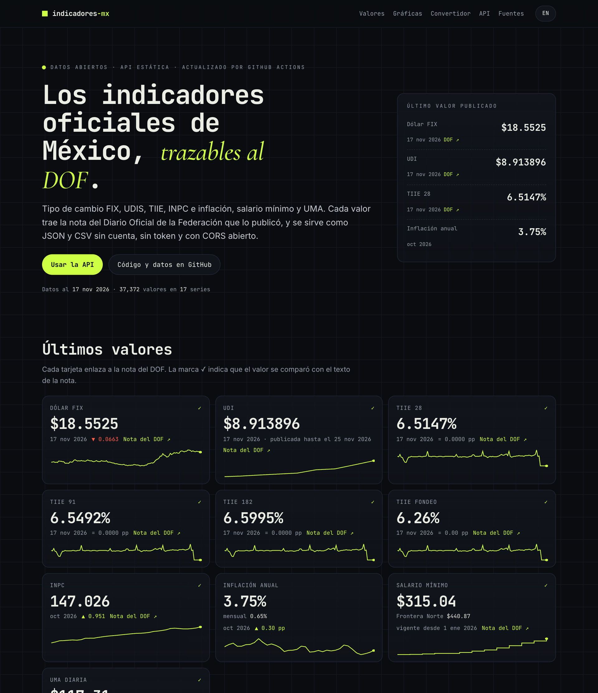
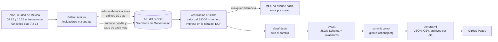

<p align="center">
  <a href="https://pivotek.mx"></a>
</p>

<p align="center">
  
</p>

<p align="center">
  <a href="README.md">English</a> · <b>Español</b>
</p>

<p align="center">
  <a href="https://github.com/BEG-lag/indicadores-mx/actions/workflows/update.yml"></a>
  <a href="https://github.com/BEG-lag/indicadores-mx/actions/workflows/ci.yml"></a>
  
  
  
  
</p>

**indicadores-mx** es un dataset abierto y vivo, y una API estática gratuita en JSON y CSV, de los
indicadores económicos oficiales de México: el tipo de cambio FIX, las UDIS, la TIIE a 28, 91 y 182
días y la TIIE de fondeo, el INPC con la inflación mensual y anual, el salario mínimo general y el
de la Zona Libre de la Frontera Norte, y la UMA. Cada valor enlaza a la nota del *Diario Oficial de
la Federación* (DOF) que lo publicó. GitHub Actions lee las fuentes oficiales cada día hábil,
compara cada valor nuevo con el texto de su nota del DOF, hace commit solo cuando algo cambió y
vuelve a publicar la API en GitHub Pages.

**Sitio y API:** [beg-lag.github.io/indicadores-mx](https://beg-lag.github.io/indicadores-mx/) ·
**Catálogo:** [`v1/index.json`](https://beg-lag.github.io/indicadores-mx/v1/index.json) ·
**Datos:** [`data/`](data) · **Esquemas:** [`schema/`](schema) · **Fuentes y errores
encontrados:** [`docs/fuentes.md`](docs/fuentes.md)

<p align="center">
  
</p>
<p align="center"><sub>Captura real del sitio servido en local con los datos de este repositorio.</sub></p>

## Qué contiene

Carga inicial hecha el 17-11-2026 desde el primer registro oficial de cada serie. "Con nota del
DOF" cuenta los valores ligados a la nota específica del DOF que los publicó; "comparados con la
nota" cuenta los valores cuyo número se comparó con el texto de esa nota y coincidió.

<!-- gen:coverage es -->
| Serie | `id` | Desde | Hasta | Valores | Con nota del DOF | Comparados con la nota | Estatus |
| --- | --- | --- | --- | ---: | ---: | ---: | --- |
| Dólar FIX | `fix` | 1991-11-13 | 2026-11-17 | 8,793 | 8,471 | 1,536 | AMARILLO |
| UDI | `udis` | 1995-04-04 | 2026-11-25 | 11,559 | 10,491 | 10,491 | VERDE |
| TIIE 28 | `tiie-28` | 1995-03-23 | 2026-11-17 | 7,743 | 7,729 | 2,701 | AMARILLO |
| TIIE 91 | `tiie-91` | 1997-01-16 | 2026-11-17 | 5,200 | 5,187 | 676 | AMARILLO |
| TIIE 182 | `tiie-182` | 2011-04-07 | 2026-11-17 | 1,375 | 1,372 | 513 | AMARILLO |
| TIIE fondeo | `tiie-fondeo` | 2020-01-20 | 2026-11-17 | 1,718 | 1,718 | 533 | AMARILLO |
| INPC | `inpc` | 2003-01 | 2026-10 | 286 | 99 | 99 | AMARILLO |
| Inflación mensual | `inflacion-mensual` | 2003-02 | 2026-10 | 285 | 0 | 0 | AMARILLO |
| Inflación anual | `inflacion-anual` | 2004-01 | 2026-10 | 274 | 0 | 0 | AMARILLO |
| Salario mínimo | `salario-minimo-general` | 2015-10-01 | 2026-01-01 | 13 | 13 | 13 | VERDE |
| Salario mínimo ZLFN | `salario-minimo-zlfn` | 2019-01-01 | 2026-01-01 | 8 | 8 | 8 | VERDE |
| Salario mínimo área A | `salario-minimo-area-a` | 1993-01-01 | 2015-04-01 | 30 | 30 | 30 | VERDE |
| Salario mínimo área B | `salario-minimo-area-b` | 1993-01-01 | 2015-04-01 | 30 | 30 | 30 | VERDE |
| Salario mínimo área C | `salario-minimo-area-c` | 1993-01-01 | 2012-01-01 | 25 | 25 | 25 | VERDE |
| UMA diaria | `uma-diaria` | 2016-01-28 | 2026-02-01 | 11 | 11 | 11 | VERDE |
| UMA mensual | `uma-mensual` | 2016-01-28 | 2026-02-01 | 11 | 11 | 11 | VERDE |
| UMA anual | `uma-anual` | 2016-01-28 | 2026-02-01 | 11 | 11 | 11 | VERDE |
<!-- /gen -->

**37,372 valores en 17 series.** Lo principal de la carga:

- **Cada valor tiene fuente.** Más de 35,000 están ligados a la nota exacta del DOF que los
  publicó (código y URL oficial); el resto indica el registro de indicadores del SIDOF o el archivo
  de datos abiertos del INEGI.
- **Más de 16,600 valores cotejados uno por uno con el texto de su nota del DOF**: 10,491 de las
  11,559 UDIS (cada periodo cuya tabla en el DOF es texto legible), todo el FIX, la TIIE y la TIIE de fondeo desde 2025, todo el FIX de 1993 a
  1995, la primera publicación de cada mes, todo el INPC desde agosto de 2018 y todos los salarios
  mínimos y la UMA.
- **La TIIE a 28 días de 1995 a 2003**, que no está en el registro de indicadores del SIDOF (empieza
  en 2004), recuperada de 2,020 notas del DOF.
- **Errores encontrados en las fuentes y resueltos** (detalle en
  [`docs/fuentes.md`](docs/fuentes.md), sección 5): valores duplicados o contradictorios en el
  SIDOF (FIX, TIIE 28, TIIE 182, cinco días de UDIS), días que faltan en el SIDOF, una UDI con un
  dígito equivocado que corrigió una fe de erratas, la errata del INPC de agosto de 2018, una TIIE
  de 2024 corregida por nota aclaratoria, un FIX corregido en 1995, una resolución de salario
  mínimo que omitió el monto, notas archivadas con otra fecha y un valor de TIIE 91 del SIDOF que
  ninguna nota del DOF respalda.

## Usa la API

URL base `https://beg-lag.github.io/indicadores-mx/v1/`. Archivos estáticos, sin cuenta, sin
token, con CORS abierto (`Access-Control-Allow-Origin: *`, el de GitHub Pages). El prefijo `v1` es
una promesa: se pueden agregar campos, nunca renombrarlos ni quitarlos.

| Ruta | Qué contiene |
| --- | --- |
| `v1/index.json` | Catálogo: cada serie con nombre (es, en), unidad, qué significa su `date`, fundamento legal, cobertura, último valor, fuentes y rutas. |
| `v1/{serie}/latest.json` | El valor más reciente y el anterior. |
| `v1/{serie}/{AAAA}.json` | Todos los valores de un año. |
| `v1/{serie}/{AAAA-MM-DD}.json` | Un día, en las series diarias. Un día sin publicación (fin de semana, día inhábil) da 404: toma el archivo del año y el último valor en o antes de la fecha. |
| `v1/{serie}/{AAAA-MM}.json` | Un mes, en el INPC y la inflación. |
| `v1/{serie}/all.json`, `all.csv` | La serie completa con la fuente de cada valor. |
| `v1/{serie}/compact.json` | `dates` y `values` en dos arreglos, para gráficas. |
| `schema/v1/*.schema.json` | JSON Schema de cada archivo. |

Series: `fix`, `udis`, `tiie-28`, `tiie-91`, `tiie-182`, `tiie-fondeo`, `inpc`,
`inflacion-mensual`, `inflacion-anual`, `salario-minimo-general`, `salario-minimo-zlfn`,
`salario-minimo-area-a`, `salario-minimo-area-b`, `salario-minimo-area-c`, `uma-diaria`,
`uma-mensual`, `uma-anual`.

### curl

```bash
curl -s https://beg-lag.github.io/indicadores-mx/v1/fix/2026-11-13.json
```

<!-- gen:example fix/2026-11-13.json -->
```json
{
  "series": "fix",
  "name": {
    "es": "Tipo de cambio FIX (para solventar obligaciones en moneda extranjera)",
    "en": "FIX exchange rate (to settle foreign currency obligations)"
  },
  "unit": "MXN/USD",
  "unit_label": {
    "es": "pesos por dólar",
    "en": "pesos per US dollar"
  },
  "date": "2026-11-13",
  "value": 18.6188,
  "source": {
    "origin": "sidof",
    "dof_date": "2026-11-13",
    "dof_note": 5803775,
    "url": "https://dof.gob.mx/nota_detalle.php?codigo=5803775&fecha=13/11/2026",
    "checked": true
  }
}
```
<!-- /gen -->

`date` es el día en que el tipo de cambio sirve para solventar obligaciones, normalmente el de su
publicación en el DOF. La nota dice que el Banco de México lo determinó el día hábil bancario
anterior, que es como fecha su serie del SIE. Cada serie explica qué significa su fecha en
`v1/index.json` (`date_meaning`).

Un mes del INPC, con la corrección que el INEGI publicó al día siguiente:

<!-- gen:example inpc/2018-08.json -->
```json
{
  "series": "inpc",
  "name": {
    "es": "Índice Nacional de Precios al Consumidor (INPC)",
    "en": "National Consumer Price Index (INPC)"
  },
  "unit": "index",
  "unit_label": {
    "es": "índice, 2a. quincena de julio de 2018 = 100",
    "en": "index, second half of July 2018 = 100"
  },
  "date": "2018-08",
  "value": 100.492,
  "source": {
    "origin": "dof",
    "dof_date": "2018-09-10",
    "dof_note": 5537424,
    "url": "https://dof.gob.mx/nota_detalle.php?codigo=5537424&fecha=10/09/2018",
    "checked": true,
    "correction": {
      "dof_date": "2018-09-11",
      "dof_note": 5537585,
      "url": "https://dof.gob.mx/nota_detalle.php?codigo=5537585&fecha=11/09/2018"
    },
    "remark": "La nota del 2018-09-10 publicó 100.942 (variación 4.90%); la nota aclaratoria del 2018-09-11 lo corrigió a 100.492."
  }
}
```
<!-- /gen -->

Las primeras filas de un CSV:

<!-- gen:csv tiie-28 3 -->
```csv
date,value,valid_to,term_days,origin,dof_date,dof_note,url,checked,correction_dof_date,correction_dof_note,remark
1995-03-23,90.5000,,,dof,1995-03-23,4871280,https://dof.gob.mx/nota_detalle.php?codigo=4871280&fecha=23/03/1995,true,,,Sin valor en el SIDOF; se tomó de la nota del DOF.
1995-03-30,88.4650,,,dof,1995-03-30,4871630,https://dof.gob.mx/nota_detalle.php?codigo=4871630&fecha=30/03/1995,true,,,Sin valor en el SIDOF; se tomó de la nota del DOF.
1995-04-06,88.6000,,,dof,1995-04-06,4872051,https://dof.gob.mx/nota_detalle.php?codigo=4872051&fecha=06/04/1995,true,,,Sin valor en el SIDOF; se tomó de la nota del DOF.
```
<!-- /gen -->

### JavaScript

```js
const base = "https://beg-lag.github.io/indicadores-mx/v1";
const fix = await fetch(`${base}/fix/latest.json`).then((r) => r.json());
console.log(fix.date, fix.value, fix.source.url);

// La UDI de cualquier día natural (se publica hasta con dos semanas de anticipación)
const udi = await fetch(`${base}/udis/2026-11-17.json`).then((r) => r.json());

// Una fecha sin publicación: el último valor en o antes de ella
const year = await fetch(`${base}/fix/2026.json`).then((r) => r.json());
const onOrBefore = (d) => year.observations.findLast((o) => o.date <= d);
```

### Python

```python
import csv, io, json, urllib.request

BASE = "https://beg-lag.github.io/indicadores-mx/v1"

with urllib.request.urlopen(f"{BASE}/inpc/latest.json") as r:
    inpc = json.load(r)
print(inpc["date"], inpc["value"], inpc["source"]["url"])

with urllib.request.urlopen(f"{BASE}/udis/all.csv") as r:
    rows = list(csv.DictReader(io.TextIOWrapper(r, "utf-8")))
print(len(rows), rows[-1]["date"], rows[-1]["value"])
```

Para aritmética exacta, lee `value` como decimal (`json.loads(texto, parse_float=Decimal)` en
Python): los archivos escriben cada número con los dígitos que imprimió el DOF.

### Campos de la fuente

| Campo | Significado |
| --- | --- |
| `origin` | De dónde se leyó el número: `sidof` (API de indicadores del SIDOF, espejo del DOF), `dof` (el texto de la nota del DOF), `inegi` (datos abiertos del INEGI, INPC anterior a agosto de 2018) o `derived` (calculado aquí: inflación). |
| `dof_date`, `dof_note`, `url` | La nota del DOF que publicó el valor y su página oficial en dof.gob.mx. |
| `checked` | `true` si el valor se comparó con el texto de esa nota y coincidió. |
| `correction` | Una nota posterior del DOF que corrigió el valor publicado (nota aclaratoria). |
| `remark` | Por qué un valor difiere de la fuente cruda, por ejemplo un duplicado del SIDOF que se resolvió con la nota. |
| `term_days` (TIIE) | El plazo que dice la nota cuando el Banco de México movió el vencimiento por un día inhábil (29 días en lugar de 28, por ejemplo). |
| `valid_to` (salarios mínimos, UMA) | Último día en que rigió el valor; `null` mientras rige. |

## Cómo funciona



| Flujo | Cuándo (Ciudad de México, UTC-6 todo el año) | Qué hace |
| --- | --- | --- |
| [`update.yml`](.github/workflows/update.yml) | 08:25 y 14:25, de lunes a viernes | FIX, TIIE, TIIE de fondeo y UDIS. Banxico determina el FIX y la TIIE a mediodía y salen en el DOF de la mañana siguiente; las UDIS se publican los días 10 y 25. Relee 10 días, así que recoge una edición tardía o una corrida perdida. |
| [`update.yml`](.github/workflows/update.yml) | 09:40 los días 7 a 14 | INPC, que el INEGI publica en el DOF dentro de los primeros diez días del mes (Código Fiscal de la Federación, art. 20). Recalcula la inflación y la compara con la variación impresa en la nota. |
| [`annual.yml`](.github/workflows/annual.yml) | 28 de diciembre y 12 de enero, 09:00 | Resolución del salario mínimo (CONASAMI, diciembre) y UMA (INEGI, enero). Lee la nota nueva, escribe un reporte y **espera a que una persona apruebe** el entorno `annual-review` antes de hacer commit. |
| [`pages.yml`](.github/workflows/pages.yml) | tras un commit de datos, o en push | Genera `/v1` desde `data/`, lo valida contra los esquemas y publica Pages. |
| [`ci.yml`](.github/workflows/ci.yml) | cada push y pull request | Ruff y las pruebas en Python 3.12, 3.13 y 3.14 con respuestas grabadas (sin red). |

Verificaciones que detienen una actualización sin escribir nada: un valor del SIDOF distinto del
número impreso en su nota del DOF; un valor que cambió después de publicado; un hueco en el
calendario de UDIS o un salto diario mayor a 1%; una UDI de la tabla del Banco de México que falta
en el SIDOF; una nota del INPC cuya variación mensual impresa no cuadra con los índices (entonces
busca una nota aclaratoria, como pasó en agosto de 2018); un INPC del mes anterior impreso
distinto del que hay en los datos; un valor anual que no aparece en el texto de su nota.

Las peticiones son secuenciales y corteses: `User-Agent` descriptivo, pausa entre peticiones,
reintentos con espera exponencial ante 429 y 5xx, y el encabezado `Accept` que pide el SIDOF (un
`application/json` solo devuelve HTTP 406). No se usa ninguna cuenta ni token.

## Córrelo tú

```bash
uv sync
uv run indicadores-mx update                  # lo que corre el flujo programado
uv run indicadores-mx backfill                # reconstruye desde el primer registro (caché reanudable)
uv run indicadores-mx verify-steps            # coteja salarios mínimos y UMA con sus notas
uv run indicadores-mx annual --kind uma       # busca un valor anual nuevo
uv run indicadores-mx build --out _site       # la API y el sitio
uv run indicadores-mx stats                   # cobertura de cada serie
uv run pytest                                 # pruebas, esquemas, invariantes del dataset
python -m http.server 8000 --directory _site  # abre http://localhost:8000
```

La carga completa lee unos 9,700 sumarios del DOF y unas 6,700 notas; las respuestas se guardan en
`.cache/` (ignorado por git) para poder reanudarla.

## Estructura

```text
src/indicadores_mx/
  sidof.py      cliente del SIDOF: secuencial, reintentos, User-Agent, caché en disco
  dof.py        lectores de cada nota del DOF (FIX, TIIE, tabla de UDIS, INPC, UMA, salario mínimo)
  pipeline.py   cruza los valores del SIDOF con sus notas; todas las verificaciones
  store.py      data/<serie>.json, una observación por línea, se escribe solo si cambia
  api.py        la API estática /v1 (JSON, CSV, archivos por día) y el catálogo
  annual.py     detección anual de salario mínimo y UMA
  catalog.py    las series y sus metadatos bilingües
  cli.py        backfill, update, verify-steps, annual, build, stats
data/           el dataset (CC0)
schema/         JSON Schemas: archivos de datos y cada archivo de la API
site/           el sitio estático (JS sin dependencias, tipografías autoalojadas, sin terceros)
tests/          lectores con notas reales, verificaciones, actualización de punta a punta, esquemas
scripts/        banner, ejemplos del README, capturas, grabadora de respuestas
docs/fuentes.md fuentes, estatus por serie, errores encontrados y cómo se resolvieron
```

## Limitaciones

- **Verificación por muestra en valores diarios antiguos.** Se compararon con el texto de su nota
  del DOF todos los valores del FIX, la TIIE y la TIIE de fondeo desde el 1 de enero de 2025, la
  primera publicación de cada mes anterior y cada valor que el SIDOF no tenía o tenía duplicado.
  Los demás están ligados a su nota, pero su número viene del SIDOF sin cotejar
  (`checked: false`). Los valores nuevos siempre se cotejan.
- **Sin nota del DOF donde el sumario del SIDOF no la tiene.** El FIX de noviembre de 1991 a
  diciembre de 1992 no tiene nota del Banco de México en el sumario del SIDOF; esos valores vienen
  solo del registro de indicadores del SIDOF, que los expresa en pesos actuales (1 peso = 1,000
  pesos de 1992).
- **El INPC anterior a agosto de 2018** viene de los datos abiertos del INEGI, reexpresado en base
  2018, no de las notas del DOF de la época (en bases anteriores). La serie empieza en enero de
  2003. El archivo del INEGI termina en julio de 2024; el DOF cubre cada mes desde agosto de 2018.
- **La fecha del FIX.** El SIE del Banco de México fecha el FIX por el día en que se determinó;
  aquí se fecha por el día en que sirve para solventar obligaciones (su publicación en el DOF), un
  día hábil bancario después.
- **Plazos de la TIIE.** Cuando un vencimiento cae en día inhábil, el Banco de México publica, por
  ejemplo, una tasa a 29 días en lugar de 28. Aquí se conserva en la serie de 28 días con
  `term_days: 29`.
- **Los valores anuales se capturan a mano.** Los salarios mínimos (desde 1993) y la UMA (desde
  2016) se leen de cada resolución y se cotejan con el texto de la nota; el flujo anual propone los
  nuevos y espera la revisión de una persona.
- **Cambios en la fuente.** La API del SIDOF no está documentada oficialmente. Si cambia, la corrida
  programada falla a la vista en lugar de guardar datos malos. GitHub puede retrasar las corridas
  programadas y las pausa en repositorios sin actividad durante 60 días.
- **Los archivos por día solo existen para días con publicación.** Un fin de semana o día inhábil
  responde 404 a propósito.

## Advertencia

**Espejo no oficial. Solo el DOF y las instituciones que emiten cada indicador tienen validez
oficial.** Este proyecto no está afiliado al Banco de México, al INEGI, a la CONASAMI, a la
Secretaría de Gobernación ni al DOF. Los valores se leen de fuentes oficiales públicas y se
verifican como se describe arriba, pero pueden contener errores; cotéjalos con la publicación
oficial antes de usarlos para algo formal. Nada de esto constituye opinión legal ni asesoría
fiscal.

## Autor

Hecho por **Benjamín Esponda García**, abogado mexicano que construye con IA. Más en
[pivotek.mx](https://pivotek.mx) y en el [portafolio](https://github.com/BEG-lag/portafolio-ia).
Proyectos hermanos: [mcp-dof](https://github.com/BEG-lag/mcp-dof) (el DOF para asistentes de IA,
donde se documentó la API del SIDOF), [dof-diario](https://github.com/BEG-lag/dof-diario) (el
sumario del DOF como dataset) y [aumento-renta](https://github.com/BEG-lag/aumento-renta)
(actualización de rentas por INPC o UDIS, donde se escribieron las verificaciones del INPC y las
UDIS que se usan aquí).

Código bajo la [licencia MIT](LICENSE). Datos dedicados al dominio público bajo CC0
([DATA-LICENSE.md](DATA-LICENSE.md)). Versión 1.0.0.
