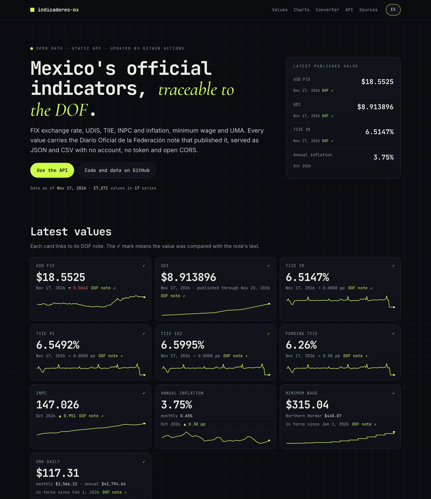
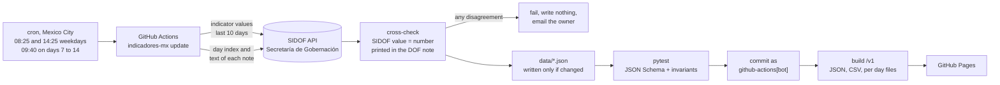

<p align="center">
  
</p>

<p align="center">
  <b>English</b> · <a href="README.es.md">Español</a>
</p>

<p align="center">
  <a href="https://github.com/BEG-lag/indicadores-mx/actions/workflows/update.yml"></a>
  <a href="https://github.com/BEG-lag/indicadores-mx/actions/workflows/ci.yml"></a>
  
  
  
  
</p>

**indicadores-mx** is a living open dataset and a free static JSON/CSV API of Mexico's official
economic indicators: the FIX exchange rate, UDIS, the 28, 91 and 182-day TIIE and the overnight
funding TIIE, the INPC with monthly and annual inflation, the general and Northern Border minimum
wages and the UMA. Every value links to the note of the *Diario Oficial de la Federación* (DOF)
that published it. GitHub Actions reads the official sources every business day, compares each
new value with the text of its DOF note, commits only when something changed and republishes the
API on GitHub Pages.

**Site and API:** [beg-lag.github.io/indicadores-mx](https://beg-lag.github.io/indicadores-mx/) ·
**Catalog:** [`v1/index.json`](https://beg-lag.github.io/indicadores-mx/v1/index.json) ·
**Data:** [`data/`](data) · **Schemas:** [`schema/`](schema) · **Sources and errors found:**
[`docs/fuentes.md`](docs/fuentes.md) (Spanish)

<p align="center">
  
</p>
<p align="center"><sub>Real screenshot of the site served locally with the data in this repository (Spanish by default, English toggle).</sub></p>

## What is in it

Backfill run on 2026-11-17 from the first official record of each series. "With DOF note" counts
values linked to the specific DOF note that published them; "checked" counts values whose number
was compared with the text of that note and matched.

<!-- gen:coverage en -->
| Series | `id` | From | To | Values | With DOF note | Checked against the note | Status |
| --- | --- | --- | --- | ---: | ---: | ---: | --- |
| USD FIX | `fix` | 1991-11-13 | 2026-11-17 | 8,793 | 8,471 | 1,536 | AMARILLO |
| UDI | `udis` | 1995-04-04 | 2026-11-25 | 11,559 | 10,491 | 10,491 | VERDE |
| TIIE 28 | `tiie-28` | 1995-03-23 | 2026-11-17 | 7,743 | 7,729 | 2,701 | AMARILLO |
| TIIE 91 | `tiie-91` | 1997-01-16 | 2026-11-17 | 5,200 | 5,187 | 676 | AMARILLO |
| TIIE 182 | `tiie-182` | 2011-04-07 | 2026-11-17 | 1,375 | 1,372 | 513 | AMARILLO |
| Funding TIIE | `tiie-fondeo` | 2020-01-20 | 2026-11-17 | 1,718 | 1,718 | 533 | AMARILLO |
| INPC | `inpc` | 2003-01 | 2026-10 | 286 | 99 | 99 | AMARILLO |
| Monthly inflation | `inflacion-mensual` | 2003-02 | 2026-10 | 285 | 0 | 0 | AMARILLO |
| Annual inflation | `inflacion-anual` | 2004-01 | 2026-10 | 274 | 0 | 0 | AMARILLO |
| Minimum wage | `salario-minimo-general` | 2015-10-01 | 2026-01-01 | 13 | 13 | 13 | VERDE |
| Minimum wage ZLFN | `salario-minimo-zlfn` | 2019-01-01 | 2026-01-01 | 8 | 8 | 8 | VERDE |
| Minimum wage area A | `salario-minimo-area-a` | 1993-01-01 | 2015-04-01 | 30 | 30 | 30 | VERDE |
| Minimum wage area B | `salario-minimo-area-b` | 1993-01-01 | 2015-04-01 | 30 | 30 | 30 | VERDE |
| Minimum wage area C | `salario-minimo-area-c` | 1993-01-01 | 2012-01-01 | 25 | 25 | 25 | VERDE |
| UMA daily | `uma-diaria` | 2016-01-28 | 2026-02-01 | 11 | 11 | 11 | VERDE |
| UMA monthly | `uma-mensual` | 2016-01-28 | 2026-02-01 | 11 | 11 | 11 | VERDE |
| UMA annual | `uma-anual` | 2016-01-28 | 2026-02-01 | 11 | 11 | 11 | VERDE |
<!-- /gen -->

**37,372 values in 17 series.** Highlights of the backfill:

- **Every value has a source.** 35,000+ are linked to the exact DOF note that published them
  (code and official URL); the rest name the SIDOF indicator record or INEGI's open data file.
- **16,600+ values compared one by one with the text of their DOF note**: 10,491 of the 11,559
  UDIs (every period whose DOF table is readable text), every FIX, TIIE and funding TIIE since 2025, every FIX of 1993 to 1995, the first
  publication of every month, every INPC since August 2018 and every minimum wage and UMA.
- **The 28-day TIIE from 1995 to 2003**, which SIDOF's indicator record lacks (it starts in 2004),
  recovered from 2,020 DOF notes.
- **Source errors found and settled** (details in [`docs/fuentes.md`](docs/fuentes.md), section
  5): duplicated or conflicting SIDOF values (FIX, TIIE 28, TIIE 182, five UDI days), days missing
  from SIDOF, a UDI printed with a wrong digit and fixed by a fe de erratas, the August 2018
  INPC typo, a 2024 TIIE typo fixed by a nota aclaratoria, a FIX corrected in 1995, a minimum wage
  resolution that omitted the amount, notes filed under the wrong date, and one SIDOF TIIE 91
  value that no DOF note supports.

## Use the API

Base URL `https://beg-lag.github.io/indicadores-mx/v1/`. Static files, no account, no token, CORS
open (`Access-Control-Allow-Origin: *`, GitHub Pages' default). The version prefix `v1` is a
promise: fields may be added, never renamed or removed.

| Path | Contents |
| --- | --- |
| `v1/index.json` | Catalog: every series with names (es, en), unit, what its `date` means, legal basis, coverage, latest value, sources and endpoints. |
| `v1/{series}/latest.json` | The most recent value and the previous one. |
| `v1/{series}/{YYYY}.json` | Every value of one calendar year. |
| `v1/{series}/{YYYY-MM-DD}.json` | One day, for daily series. A day with no publication (weekend, holiday) is a 404: take the year file and the last value on or before the date. |
| `v1/{series}/{YYYY-MM}.json` | One month, for the INPC and inflation. |
| `v1/{series}/all.json`, `all.csv` | The whole series with the source of every value. |
| `v1/{series}/compact.json` | `dates` and `values` as two arrays, for charts. |
| `schema/v1/*.schema.json` | JSON Schema of every file above. |

Series ids: `fix`, `udis`, `tiie-28`, `tiie-91`, `tiie-182`, `tiie-fondeo`, `inpc`,
`inflacion-mensual`, `inflacion-anual`, `salario-minimo-general`, `salario-minimo-zlfn`,
`salario-minimo-area-a`, `salario-minimo-area-b`, `salario-minimo-area-c`, `uma-diaria`,
`uma-mensual`, `uma-anual`.

### curl

```bash
curl -s https://beg-lag.github.io/indicadores-mx/v1/fix/2026-11-13.json
```

<!-- gen:example fix/2026-11-13.json -->
```json
{
  "series": "fix",
  "name": {
    "es": "Tipo de cambio FIX (para solventar obligaciones en moneda extranjera)",
    "en": "FIX exchange rate (to settle foreign currency obligations)"
  },
  "unit": "MXN/USD",
  "unit_label": {
    "es": "pesos por dólar",
    "en": "pesos per US dollar"
  },
  "date": "2026-11-13",
  "value": 18.6188,
  "source": {
    "origin": "sidof",
    "dof_date": "2026-11-13",
    "dof_note": 5803775,
    "url": "https://dof.gob.mx/nota_detalle.php?codigo=5803775&fecha=13/11/2026",
    "checked": true
  }
}
```
<!-- /gen -->

`date` is the day the rate settles obligations, normally its DOF publication date. The note says
Banco de México determined it the previous banking day, which is how Banxico's own SIE series is
dated. Each series states what its date means in `v1/index.json` (`date_meaning`).

A month of the INPC, with the correction INEGI published the next day:

<!-- gen:example inpc/2018-08.json -->
```json
{
  "series": "inpc",
  "name": {
    "es": "Índice Nacional de Precios al Consumidor (INPC)",
    "en": "National Consumer Price Index (INPC)"
  },
  "unit": "index",
  "unit_label": {
    "es": "índice, 2a. quincena de julio de 2018 = 100",
    "en": "index, second half of July 2018 = 100"
  },
  "date": "2018-08",
  "value": 100.492,
  "source": {
    "origin": "dof",
    "dof_date": "2018-09-10",
    "dof_note": 5537424,
    "url": "https://dof.gob.mx/nota_detalle.php?codigo=5537424&fecha=10/09/2018",
    "checked": true,
    "correction": {
      "dof_date": "2018-09-11",
      "dof_note": 5537585,
      "url": "https://dof.gob.mx/nota_detalle.php?codigo=5537585&fecha=11/09/2018"
    },
    "remark": "La nota del 2018-09-10 publicó 100.942 (variación 4.90%); la nota aclaratoria del 2018-09-11 lo corrigió a 100.492."
  }
}
```
<!-- /gen -->

The first rows of a CSV:

<!-- gen:csv tiie-28 3 -->
```csv
date,value,valid_to,term_days,origin,dof_date,dof_note,url,checked,correction_dof_date,correction_dof_note,remark
1995-03-23,90.5000,,,dof,1995-03-23,4871280,https://dof.gob.mx/nota_detalle.php?codigo=4871280&fecha=23/03/1995,true,,,Sin valor en el SIDOF; se tomó de la nota del DOF.
1995-03-30,88.4650,,,dof,1995-03-30,4871630,https://dof.gob.mx/nota_detalle.php?codigo=4871630&fecha=30/03/1995,true,,,Sin valor en el SIDOF; se tomó de la nota del DOF.
1995-04-06,88.6000,,,dof,1995-04-06,4872051,https://dof.gob.mx/nota_detalle.php?codigo=4872051&fecha=06/04/1995,true,,,Sin valor en el SIDOF; se tomó de la nota del DOF.
```
<!-- /gen -->

### JavaScript

```js
const base = "https://beg-lag.github.io/indicadores-mx/v1";
const fix = await fetch(`${base}/fix/latest.json`).then((r) => r.json());
console.log(fix.date, fix.value, fix.source.url);

// The UDI of any calendar day (published up to two weeks ahead)
const udi = await fetch(`${base}/udis/2026-11-17.json`).then((r) => r.json());

// A date without publication: the last value on or before it
const year = await fetch(`${base}/fix/2026.json`).then((r) => r.json());
const onOrBefore = (d) => year.observations.findLast((o) => o.date <= d);
```

### Python

```python
import csv, io, json, urllib.request

BASE = "https://beg-lag.github.io/indicadores-mx/v1"

with urllib.request.urlopen(f"{BASE}/inpc/latest.json") as r:
    inpc = json.load(r)
print(inpc["date"], inpc["value"], inpc["source"]["url"])

with urllib.request.urlopen(f"{BASE}/udis/all.csv") as r:
    rows = list(csv.DictReader(io.TextIOWrapper(r, "utf-8")))
print(len(rows), rows[-1]["date"], rows[-1]["value"])
```

For exact arithmetic, read `value` as a decimal (`json.loads(text, parse_float=Decimal)` in
Python): the files write every number with the digits the DOF printed.

### Every source field

| Field | Meaning |
| --- | --- |
| `origin` | Where the number was read: `sidof` (SIDOF's indicator API, which mirrors the DOF), `dof` (the text of the DOF note), `inegi` (INEGI open data, INPC before August 2018) or `derived` (computed here: inflation). |
| `dof_date`, `dof_note`, `url` | The DOF note that published the value and its official page on dof.gob.mx. |
| `checked` | `true` when the value was compared with the text of that note and matched. |
| `correction` | A later DOF note that corrected the published value (nota aclaratoria). |
| `remark` | Why a value differs from the raw source (in Spanish), for example a SIDOF duplicate settled by the note. |
| `term_days` (TIIE) | The term the note states when Banco de México moved the maturity off a holiday (29 instead of 28 days, for example). |
| `valid_to` (minimum wages, UMA) | Last day the value was in force; `null` while it is. |

## How it works



| Workflow | When (Mexico City, UTC-6 all year) | What |
| --- | --- | --- |
| [`update.yml`](.github/workflows/update.yml) | 08:25 and 14:25, Monday to Friday | FIX, TIIE, TIIE de fondeo and UDIS. Banxico determines the FIX and the TIIE at midday and they appear in the next morning's DOF; UDIS are published on the 10th and the 25th. Re-reads 10 days, so a late edition or a missed run is picked up. |
| [`update.yml`](.github/workflows/update.yml) | 09:40 on days 7 to 14 | INPC, which INEGI publishes in the DOF within the first ten days of the month (Código Fiscal de la Federación, art. 20). Recomputes inflation and checks it against the variation printed in the note. |
| [`annual.yml`](.github/workflows/annual.yml) | 28 December and 12 January, 09:00 | Minimum wage resolution (CONASAMI, December) and UMA (INEGI, January). Reads the new note, writes a report and **waits for a person to approve** the `annual-review` environment before committing. |
| [`pages.yml`](.github/workflows/pages.yml) | after a data commit, or on push | Builds `/v1` from `data/`, validates it against the schemas and deploys Pages. |
| [`ci.yml`](.github/workflows/ci.yml) | every push and pull request | Ruff, and the tests on Python 3.12, 3.13 and 3.14 with recorded fixtures (no network). |

Cross-checks that stop an update without writing anything: a SIDOF value that differs from the
number printed in its DOF note; a value that changed after publication; a gap in the UDI
calendar or a daily jump above 1%; a UDI in Banco de México's table that SIDOF lacks; an INPC note
whose printed monthly variation does not match the indexes (then the run looks for a nota
aclaratoria, as happened in August 2018); a printed previous-month INPC that differs from the
data; a yearly value that does not appear in the text of its note.

Requests are sequential and polite: a descriptive `User-Agent`, a pause between requests,
retries with exponential backoff on 429 and 5xx, and the `Accept` header SIDOF needs (a bare
`application/json` gets HTTP 406). No account or token is used anywhere.

## Run it yourself

```bash
uv sync
uv run indicadores-mx update                  # what the scheduled workflow runs
uv run indicadores-mx backfill                # rebuild from the first record (resumable cache)
uv run indicadores-mx verify-steps            # check minimum wages and UMA against their notes
uv run indicadores-mx annual --kind uma       # look for a new yearly value
uv run indicadores-mx build --out _site       # the API and the site
uv run indicadores-mx stats                   # coverage of each series
uv run pytest                                 # unit tests, schemas, dataset invariants
python -m http.server 8000 --directory _site  # open http://localhost:8000
```

The full backfill reads about 9,700 DOF tables of contents and about 6,700 notes; the responses are
cached in `.cache/` (ignored by git) so it can be resumed.

## Project structure

```text
src/indicadores_mx/
  sidof.py      SIDOF client: sequential, retries, backoff, User-Agent, disk cache
  dof.py        readers for each DOF note (FIX, TIIE, UDI table, INPC, UMA, minimum wage)
  pipeline.py   merge SIDOF values with their notes; every cross-check
  store.py      data/<series>.json, one observation per line, written only on change
  api.py        the static /v1 API (JSON, CSV, per-day files) and the catalog
  annual.py     yearly minimum wage and UMA detection
  catalog.py    the series and their bilingual metadata
  cli.py        backfill, update, verify-steps, annual, build, stats
data/           the dataset (CC0)
schema/         JSON Schemas: data files and every API file
site/           the static site (vanilla JS, self-hosted fonts, no third parties)
tests/          parsers on real notes, cross-checks, end-to-end update, schemas, site rules
scripts/        banner, README examples, screenshots, fixture recorder
docs/fuentes.md sources, status per series, errors found and how they were settled
```

## Limitations

- **Sample verification for older daily values.** Every FIX, TIIE and TIIE de fondeo value since
  1 January 2025, the first publication of every month before that, and every value that SIDOF
  lacked or duplicated were compared with the text of their DOF note. The rest are linked to their
  note but their number comes from SIDOF unchecked (`checked: false`). New values are always
  checked.
- **No DOF note before the SIDOF index has one.** The FIX from November 1991 to December 1992 has
  no Banco de México note in SIDOF's table of contents; those values come from SIDOF's indicator
  record only. SIDOF expresses them in today's pesos (1 peso = 1,000 pesos of 1992).
- **INPC before August 2018** comes from INEGI's open data, re-expressed in the 2018 base, not from
  the DOF notes of the time (printed in older bases). The series starts in January 2003.
  INEGI's file stops in July 2024; the DOF covers every month since August 2018.
- **The FIX date convention.** Banxico's SIE dates the FIX by the day it was determined; this
  dataset dates it by the day it settles obligations (its DOF publication), one banking day later.
- **TIIE terms.** When a maturity falls on a holiday Banco de México prints, for example, a 29-day
  rate instead of the 28-day one. The dataset keeps it in the 28-day series with `term_days: 29`.
- **Yearly values are curated.** Minimum wages (since 1993) and the UMA (since 2016) are entered
  from each resolution and checked against the note's text; the yearly workflow proposes new ones
  and waits for a person.
- **Upstream changes.** The SIDOF API is undocumented. If it changes, the scheduled run fails
  visibly instead of committing bad data. GitHub may delay scheduled runs and pauses them in
  repositories without activity for 60 days.
- **Per-day files only exist for publication days.** A weekend or holiday answers 404 by design.

## Disclaimer

**Unofficial mirror. Only the DOF and the issuing institutions are authoritative.** This project
is not affiliated with Banco de México, INEGI, CONASAMI, the Secretaría de Gobernación or the
DOF. Values are read from public official sources and checked as described above, but they may
contain errors; verify against the official publication before relying on them. Nothing here is
legal or tax advice.

## Author

Built by **Benjamín Esponda García**, a Mexican lawyer who builds with AI. More at
[pivotek.mx](https://pivotek.mx) and in the [portfolio](https://github.com/BEG-lag/portafolio-ia).
Sibling projects: [mcp-dof](https://github.com/BEG-lag/mcp-dof) (the DOF for AI assistants, where
the SIDOF API was first documented), [dof-diario](https://github.com/BEG-lag/dof-diario) (the DOF
table of contents as a dataset) and [aumento-renta](https://github.com/BEG-lag/aumento-renta)
(rent updates by INPC or UDIS, where the INPC and UDI checks used here were first written).

Code released under the [MIT License](LICENSE). Data dedicated to the public domain under CC0
([DATA-LICENSE.md](DATA-LICENSE.md)). Version 1.0.0.
